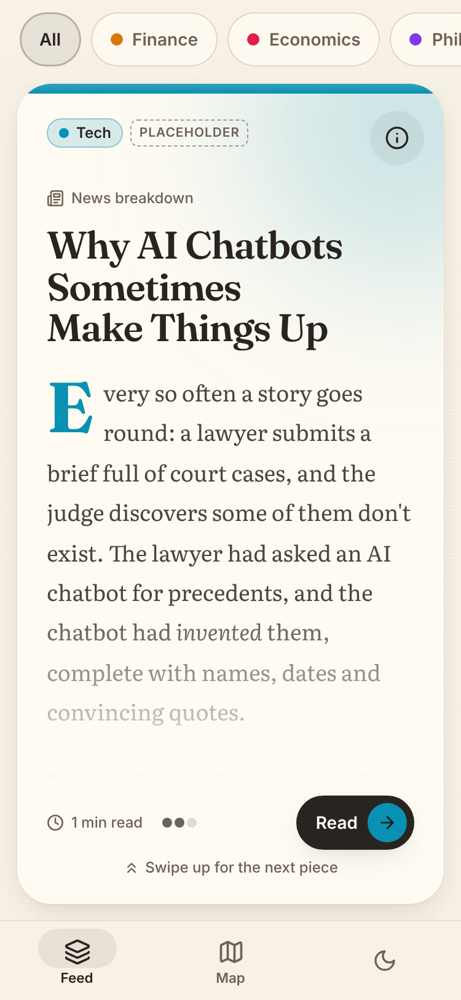
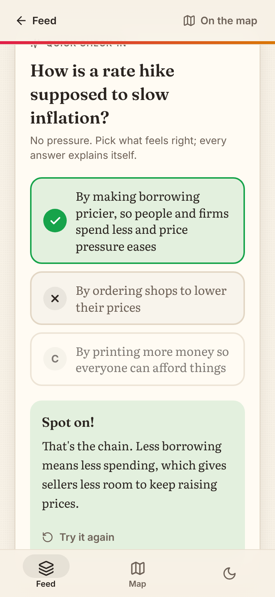
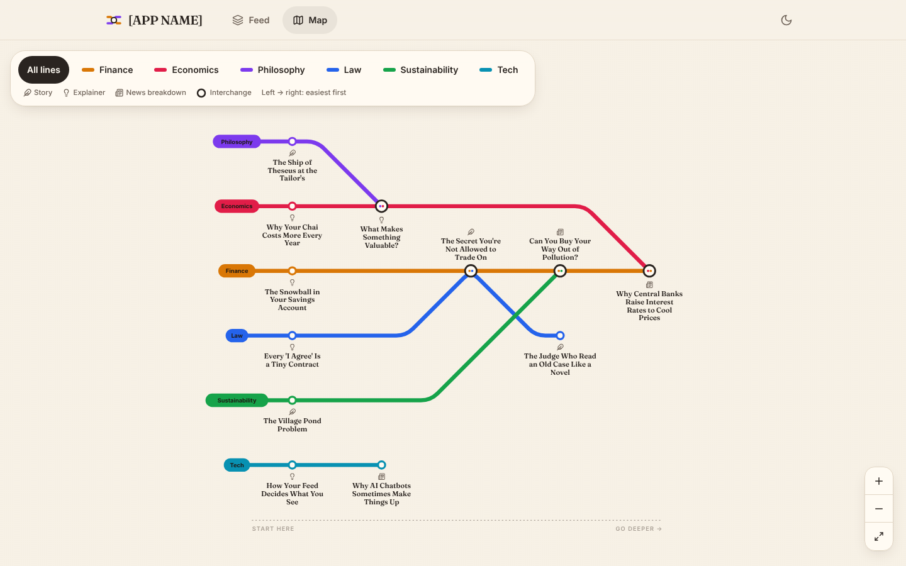

# Infolio

A mobile-first, installable (PWA) reading app: short pieces that make finance, economics,
philosophy, law, sustainability and tech easy to grasp. Built with React, Vite, TypeScript,
Tailwind CSS and Framer Motion. There's no backend; all content lives in one file.

**Live app:** https://whyashika.github.io/reading-app/ (redeploys automatically on every push to `main`).

<p>
  
  
  
</p>

## Run it

```bash
npm install
npm run dev      # local dev server at http://localhost:5173
npm run build    # production build into dist/
npm run preview  # serve the production build locally
```

The `dist/` folder is a static site: drop it on Netlify, Vercel, GitHub Pages or any static host.
Because it uses hash URLs (`/#/map`), it works from any sub-folder without server config.

## Changing the app's name

Edit `APP_NAME` in `src/config.ts`. It updates the nav bar, the browser tab title and the
name shown when someone installs the app on their phone.

## Adding or editing a piece

Everything readers see lives in **`src/content/pieces.ts`**. Each piece is one `{ ... }` block in
the `pieces` list. To add one, copy an existing block, paste it at the end of the list (before
the closing `];`), and change the fields. Save, and the piece appears in the feed, under its
subject filter and on the map automatically. You never need to touch the components.

| Field | Required | What it does |
| --- | --- | --- |
| `id` | yes | A short, unique, URL-friendly name like `"carbon-credits"`. Used in links. |
| `title` | yes | The headline. |
| `subject` | yes | One or more of `"Finance"`, `"Economics"`, `"Philosophy"`, `"Law"`, `"Sustainability"`, `"Tech"`, `"History"`, `"Culture"`. Two or more makes it an **interchange** station on the map. |
| `format` | yes | `"Story"`, `"Explainer"` or `"News breakdown"`. |
| `blurb` | yes | One or two sentences, shown in the info sheet and map preview. |
| `themes` | yes | A list of short tags shown to readers, e.g. `["Climate", "Markets"]`. |
| `body` | yes | The piece itself, between backticks. Leave a blank line between paragraphs. You can use `**bold**`, `*italic*`, `[a link](https://...)`, `## A heading`, `> a pull quote` and `- bullet lists`. Avoid typing a backtick inside the body. |
| `readingTime` | no | Minutes. Leave it out and it's worked out from the body's length. |
| `difficulty` | yes | `1` No background needed, `2` Builds on basics, `3` Deeper dive. Easier pieces sit further left on their map line. |
| `readThisFirst` | no | A list of other pieces' `id`s, e.g. `["inflation-chai"]`. Shown as a gentle nudge, and those pieces sit earlier on the map. |
| `realWorldHook` | no | `{ text: "...", type: "Timely" }` or `type: "Evergreen"`. |
| `whyToday` | no | A highlighted "Why this matters today" box near the top: `{ text: "...", link: { label: "...", url: "https://..." } }` (the link is optional). Only add it to pieces tied to the news. |
| `series` | no | `{ name: "The Price of Everything", part: 2, totalParts: 2 }`. Parts link to each other automatically. |
| `keyTerms` | yes | **Hidden** tags, never shown to readers. Pieces sharing key terms are suggested as "related". Use `[]` if none. |
| `checkIn` | yes | One question with options. Each option has `text`, `isCorrect` (`true` for the right one) and an `explanation` shown when picked, right or wrong. Write the options in any order (listing the right one first is fine): the app shuffles them for readers, and each piece always shows the same order. |
| `publishedDate` | yes | `"YYYY-MM-DD"`. The feed shows newest first. |
| `placeholder` | no | `true` shows a small "Placeholder" tag, for a piece you want to mark as unfinished. Leave it out on finished pieces. |

While `npm run dev` is running, the browser console warns you about typos such as a
`readThisFirst` id that doesn't exist or a check-in with no correct answer.

To **remove** a piece, delete its block (and remove its `id` from any other piece's `readThisFirst`).

## Glossary pop-ups

Definitions live in `src/content/glossary.ts`. The first time a term (or one of its `aliases`) appears in a piece's ordinary text, it gets a dotted underline that readers can tap. Words in **bold** are skipped, since that's where a piece explains a term itself. The starter definitions are drafts: rewrite them in your own voice.

## Listen, quote cards and the streak

- **Listen:** the Listen button in the reader reads the piece aloud with the device's built-in voice, highlighting each paragraph as it goes. Listening to the end stamps the piece.
- **Quote cards:** readers can highlight any line (up to 280 characters) and tap "Make a quote card" to share or save it as an image.
- **Reading streak:** finishing at least one piece a day (re-reads count) grows the streak on the Passport page. Miss a whole day and it starts again.

## Route planner

Readers open it from the map ("Plan my route") or the Passport page, type a goal in their own words, and get a short path of stations to read in order. Out of the box it matches the goal against each piece's subjects, themes and key terms, so filling those in well makes routes better. To switch on AI planning, follow `worker/route-planner/README.md`.

## Concept passport

Readers get a stamp for each piece they finish (they reach the end, or answer the check-in).
The **Passport** tab shows progress on every map line, the next stop on each, and which pieces
are new. Stamped pieces show a tick on the map and a "Stamped" tag in the feed.

A piece counts as **New** until it's opened if it was published in the last 30 days or since the
reader's previous visit (change `NEW_PIECE_DAYS` in `src/config.ts`). Progress is saved in the
reader's own browser (no accounts), so it doesn't follow them to another device.

## Where things live

```
src/config.ts            app name and other settings
src/content/pieces.ts    ALL the content
src/content/types.ts     the shape of a piece (field definitions)
src/lib/metroLayout.ts   builds the metro map layout from the content
src/lib/content.ts       reading time, related pieces, series helpers
src/lib/progress.ts      the reader's passport (read / new / stamped), saved in their browser
src/pages/               Feed, Reader and Map screens
src/components/          cards, sheets, check-in, map, navigation
src/index.css            colours (light/dark), subject line colours, reading typography
public/                  PWA icons and offline service worker
```

### Adding a whole new subject (a new map line)

1. Add its name to `SUBJECTS` in `src/content/types.ts`.
2. Add it to the `KEY` list in `src/lib/subjects.ts` (a short lowercase name, e.g. `art`).
3. In `src/index.css`, add `--s-art` (its line colour) and `--s-art-ink` (the text colour on top of it:
   `255 255 255` for darker colours, `29 23 18` for lighter ones), once under `:root` and once under `.dark`.
4. Give at least one piece that subject. The filter chip, map line and passport row appear by themselves.

Subject colours are the `--s-finance`, `--s-economics` ... variables in `src/index.css`
(one set for light mode, a brighter set for dark mode).

## One-file web preview

`npm run build:single` writes `dist-single/reading-app.html`: the whole app in a single page
you can open or share without a server. It uses in-memory navigation (no URL changes), so the
browser's back button doesn't move between screens there; the in-app back buttons do.
